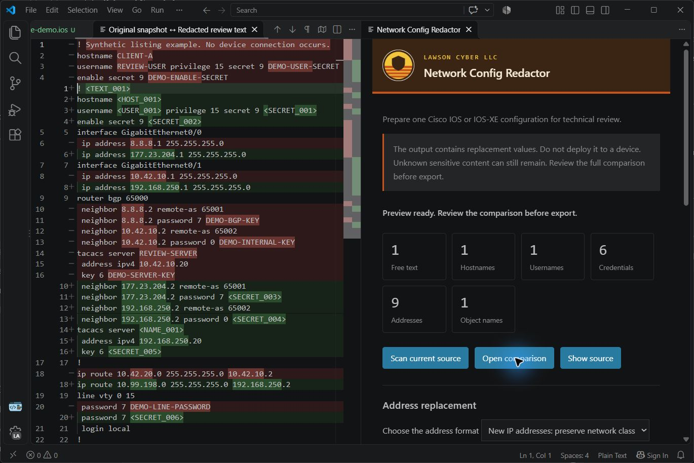

# Network Config Redactor — Lawson Cyber LLC

Prepare a supported network device configuration for technical review. Replace supported passwords, keys, names, and addresses. Review the comparison before you share the output.

## Your configs stay local

Configuration processing runs in your local desktop extension host. This extension does not upload configurations. It makes no network requests. It uses no telemetry, cloud analysis, or AI service. Configuration processing works offline.

The extension keeps the source snapshot and replacement mappings in memory. It clears its review state when you close the review panel. It writes no source logs, mapping files, or review history.

The extension changes the clipboard only when you select **Copy redacted text**. It writes an output file only when you select **Save redacted copy**. The source stays unchanged. The About button opens the company website only when you select it.

These statements describe this extension. They do not change the behavior of Visual Studio Code, other extensions, or file sync software.

## Review secrets before sharing

The scanner replaces supported cleartext passwords, encoded password values, community strings, authentication keys, and shared keys. It also replaces configured hostnames, domains, usernames, declared object names, comments, descriptions, and banner content.

The scanner treats encoded values as secrets. It does not decrypt them. Unknown sensitive forms and incomplete blocks can block export until you mask the flagged section.

The screenshots use synthetic input. The original values appear in the comparison for review.

## Device profiles

| Vendor | Supported input |
| --- | --- |
| Cisco | IOS and IOS-XE CLI configuration |
| Palo Alto Networks | PAN-OS set commands or XML export |
| Juniper | Junos display set or brace hierarchy |
| Dell | OS6, OS9 and FTOS, or SmartFabric OS10 CLI configuration |

Changing the profile clears the previous scan and manual masks. Review the new comparison before export. These profiles cover the tested forms. They do not cover every product or software version.

XML mode masks text values and attributes conservatively. It rejects external entity declarations and unsupported structure. The output is review text, not valid import data. Unsupported sensitive commands and incomplete structures require manual masking.

## Choose the address format

| Option | Result |
| --- | --- |
| Named labels | Repeated addresses use labels such as `<IP_001>`. |
| New IP addresses | Repeated addresses use the same new address. Public and private classes remain consistent. Observed subnets and host positions remain consistent. |

Internet Protocol version 4 addresses and version 6 addresses are supported. Masks and prefix lengths remain visible where the command syntax identifies them. Default routes keep their zero address in the new-address mode.

If the extension cannot map a network consistently, it blocks export. Select named labels or mask the flagged address. New-address maps support up to 2,048 distinct addresses.

## Start a review

1. Open one local configuration file or an unsaved text document.
2. Run **Lawson Cyber: Preview Redacted Configuration** from the command palette. Select the vendor and configuration format.
3. Choose the address format. Select **Open comparison**.
4. Review the full output. If a section blocks export, select **Mask this section**.
5. If the scanner missed content, select the content in the source. Run **Lawson Cyber: Redact Selected Text**. The extension also masks identical occurrences.
6. Open the updated comparison. Confirm the review checkbox.
7. Select **Copy redacted text** or **Save redacted copy**.

To try synthetic input, run **Lawson Cyber: Open Redactor Demo**.

Saving requires a new local filename. The suggested name is `redacted-config.txt`. The save action cannot overwrite the source or an existing file. Source edits invalidate the preview. A new scan clears manual masks. An address mode change requires another comparison and review.

## Scope and limits

- Desktop Visual Studio Code 1.102.0 or later.
- One device configuration per review. Select the exact vendor and format.
- Local files and unsaved text documents. Remote document sources are not supported.
- Input limit: 5 MiB, or 5,242,880 bytes. Scanning supports cancellation.
- No batch processing, device connection, configuration validation, or format conversion.

The output is review text. Do not deploy it to a device. Unknown sensitive content can still remain. New public addresses can belong to other networks. Preserved network relationships disclose some structure. Review the full output before sharing it.

## Verification

The test suite uses synthetic values. The larger example has 1,567 lines. Its checks cover 161 distinct secret values, 544 distinct addresses, and 151 network relationships. Tests check both address modes, repeated references, masks, prefixes, manual selections, cancelled scans, and export controls.

Tests in Visual Studio Code check the comparison, clipboard output, saved output, and source protection. Editor verification ran on Windows. These tests establish coverage for the seeded values and supported forms. They do not establish detection of every Cisco secret.

## Support and license

For help, email [derick@lawsoncyber.com](mailto:derick@lawsoncyber.com). Send the extension version, editor version, and reproduction steps. Use synthetic input. Do not send production configurations or live credentials.

Lawson Cyber LLC publishes this release under the [MIT license](LICENSE). The company name and logo identify Lawson Cyber LLC. They do not imply endorsement of a modified copy.

[Lawson Cyber LLC](https://lawsoncyber.com)

[Source and screenshots](https://github.com/palthainon/lawson-config-redactor) | [Report a problem](https://github.com/palthainon/lawson-config-redactor/issues)
